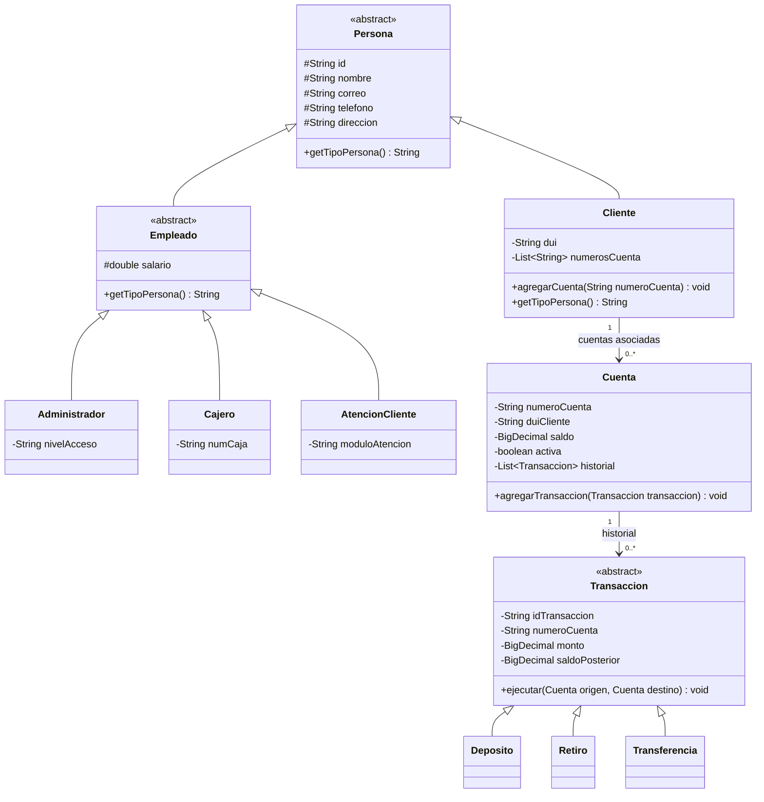

# UNIVERSIDAD EVANGÉLICA DE EL SALVADOR

**Facultad de Ingeniería – Desarrollo de Software y Ciencia de Datos**

**Asignatura:** Programación II

**Facilitador:** Ing. Daniel Enrique Guevara Gómez

**Proyecto:** Core Bancario Simplificado «FinCore» — Entrega Final

**Lugar:** San Salvador, El Salvador

## 1. Portada e Integrantes del Equipo (Grupo 09)

| N.º | Nombre | Rol Scrum | Rol técnico |
|---|---|---|---|
| 1 | Samaria Isabel Gamez González | Product Owner | Analista |
| 2 | César Fernando Estrada Martínez | Scrum Master | Desarrollador Fullstack |
| 3 | Vidal Caleb Rodríguez Paulino | Developer | Backend & Concurrencia |
| 4 | Josué Isaac Elias Bonilla | Developer | Backend & Lógica |
| 5 | Emmanuel Tomas Contreras Valle | Developer | Backend & Genéricos |
| 6 | José Efraín Silva Rodríguez | Developer | Frontend & Vistas |
| 7 | Elvis Adiel Flores | Developer | Frontend |
| 8 | Julio Agustín Garay Miranda | Developer | Despliegue & Scripts |
| 9 | Elmer Antonio Morales López | Developer | Base de Datos & JDBC |
| 10 | Jesse Maribel Mena Fuentes | QA | Pruebas Unitarias Lead |
| 11 | Iris Yesenia Arteaga de Rodríguez | QA | Mockito & Calidad |
| 12 | Nelson Alejandro Lopez Parada | Architect | Arquitecto de Software |

## 2. Introducción

Este informe actualiza la memoria académica elaborada por Samaria Isabel Gamez González en el [PR #66](https://github.com/cesarf1103-collab/FINCORE_GRUPO_9_AVANCE_3/pull/66), conservando sus 18 apartados y adaptando las explicaciones al código de `integration/avance3-final`, presentado para revisión en el [PR #67](https://github.com/cesarf1103-collab/FINCORE_GRUPO_9_AVANCE_3/pull/67).

FinCore es una aplicación bancaria académica desarrollada con Java 17 y Maven. Permite gestionar clientes y cuentas, realizar depósitos, retiros y transferencias, consultar saldos e historiales y generar reportes en segundo plano. La consola y la interfaz web local utilizan servicios comunes, repositorios y acceso JDBC a H2. Apache Commons DBCP2 administra las conexiones.

El documento distingue entre funcionalidades implementadas, resultados comprobados y mejoras futuras. Las instrucciones de instalación y ejecución se encuentran en [README.md](README.md). El proyecto no es un sistema bancario certificado ni está preparado para operar con datos financieros reales en producción.

## 3. Descripción del Problema

Una aplicación bancaria debe mantener la relación entre clientes, cuentas, saldos e historial. No basta con mostrar un saldo en pantalla: también debe conservarlo al reiniciar y evitar que una operación fallida deje modificaciones parciales.

FinCore aborda estas necesidades mediante importes `BigDecimal`, almacenamiento relacional y transacciones JDBC. En una transferencia, el débito, el crédito y sus dos movimientos se guardan con una misma conexión. Si una escritura falla antes del `commit`, se intenta revertir la operación mediante `rollback`.

Las cuentas se consultan con `SELECT ... FOR UPDATE` en un orden estable para coordinar operaciones concurrentes. Las pruebas verifican casos concretos de consistencia, rechazo y recuperación; no constituyen una certificación general de seguridad, disponibilidad o rendimiento.

## 4. Objetivos del Sistema

### 4.1 Objetivo general

Implementar y explicar un sistema bancario académico en Java 17, organizado por capas, con persistencia JDBC/H2, pool de conexiones, tareas concurrentes y pruebas automatizadas reproducibles.

### 4.2 Objetivos específicos

1. Aplicar encapsulamiento, herencia, abstracción, polimorfismo e interfaces genéricas en clases reales del proyecto.
2. Separar la recepción de solicitudes, las reglas de negocio y las consultas SQL mediante vistas, controladores, servicios y repositorios/DAO.
3. Mantener saldos e historial utilizando sentencias preparadas, restricciones SQL y transacciones con `commit` y `rollback`.
4. Generar reportes en segundo plano con `ExecutorService`, `Runnable` y `CompletableFuture`, diferenciando el ejecutor del pool de conexiones.
5. Verificar el comportamiento mediante JUnit 5, Mockito y H2, incluyendo los 17 escenarios funcionales documentados y pruebas de atomicidad y persistencia.
6. Conservar la trazabilidad del trabajo del equipo mediante issues, ramas, commits y Pull Requests, sin presentar propuestas futuras como implementaciones existentes.

## 5. Requerimientos e Historias de Usuario

La numeración oficial es la de [Historias_de_Usuario.md](docs/Historias_de_Usuario.md). La apertura de cuentas es una funcionalidad implementada de apoyo a las operaciones; no se renumeran las historias para convertirla en una HU distinta.

| Historia | Requisito y aplicación actual |
|---|---|
| HU-001 — Registro | Registrar clientes con DUI único y formato válido, datos obligatorios y validaciones de contacto. `ClienteService.registrarCliente` valida; `ClienteDAO` persiste y la base protege la unicidad. |
| HU-002 — Depósitos | Abonar un monto positivo a una cuenta activa y actualizar saldo e historial en una transacción. |
| HU-003 — Retiros | Exigir cuenta activa, monto positivo y fondos suficientes; no permitir saldos negativos. |
| HU-004 — Consulta de saldo | Recuperar los datos y el saldo actualizado mediante `CuentaService.buscarCuenta`. |
| HU-005 — Historial | Consultar movimientos por cuenta, ordenados por fecha e identificador; leerlos no vuelve a ejecutar la operación. |
| HU-006 — Depósito a terceros | Depositar en una cuenta existente de otro cliente; no requiere que el destinatario sea el titular que realiza la consulta. |
| HU-007 — Retiro en ventanilla | Comprobar coincidencia del DUI del titular y confirmación presencial del operador antes de retirar. La documentación también contempla desactivar cuentas, operación existente en el servicio. |
| HU-008 — Transferencias | Validar monto, cuentas distintas y activas y saldo suficiente; guardar débito, crédito y ambos movimientos de forma atómica. |

La [matriz funcional](docs/Matriz_de_Pruebas.md) conserva estos 17 escenarios, ejecutados por `src/test/java/com/sv/fincore/integration/EscenariosFuncionalesTest.java`:

| Caso | HU | Escenario y comprobación |
|---|---|---|
| TC-001 | HU-001 | Registro válido: el cliente puede recuperarse por DUI. |
| TC-002 | HU-001 | DUI duplicado: el servicio rechaza un segundo registro. |
| TC-003 | HU-001 | DUI inválido en el menú: se solicita corregirlo y se comprueba el registro con el dato válido. |
| TC-004 | HU-001 | Campos obligatorios vacíos en el menú: se solicita completarlos antes de registrar. |
| TC-005 | HU-002 | Depósito positivo: aumenta el saldo por el importe indicado. |
| TC-006 | HU-002 | Depósito negativo: se rechaza y se conserva el saldo. |
| TC-007 | HU-003 | Retiro con fondos: disminuye el saldo por el importe indicado. |
| TC-008 | HU-003 | Retiro sin fondos: se rechaza sin dejar saldo negativo. |
| TC-009 | HU-008 | Transferencia válida: se verifican los saldos de origen y destino. |
| TC-010 | HU-008 | Transferencia por cero: se rechaza. |
| TC-011 | HU-008 | Transferencia sin saldo suficiente: se rechaza. |
| TC-012 | HU-008 | Destino inexistente: se rechaza y no se debita el origen. |
| TC-013 | HU-008 | Transferencia negativa: se rechaza. |
| TC-014 | HU-004 | Consulta de saldo: otra instancia del servicio recupera el valor persistido. |
| TC-015 | HU-005 | Historial: un depósito y un retiro producen dos movimientos consultables. |
| TC-016 | HU-006 | Depósito a terceros: se abona correctamente en la cuenta destino. |
| TC-017 | HU-007 | Retiro de ventanilla de la matriz: comprueba el débito y saldo mediante el retiro general del servicio. |

TC-017 no demuestra por sí solo la revisión presencial de identidad. Ese control se comprueba adicionalmente en `ClienteYHistorialConsistenciaTest.retiroEnVentanillaExigeConfirmacionYCoincidenciaDeDui` y en `MenuOperacionesTest`. La consola solicita el DUI presentado y la confirmación del operador; la aplicación no reconoce documentos físicos ni autentica al operador. El retiro web general no se presenta como retiro presencial con identidad verificada.

## 6. Arquitectura del Proyecto y Estructura por Capas

El recorrido habitual es **vista → controlador → servicio → repositorio/DAO → JDBC/H2**. Una interfaz de repositorio describe operaciones; un DAO implementa ese contrato mediante SQL. `DataSourceConfig` se encuentra en `util/` y `WebMain` en `web/`.

```text
src/main/java/
├── com/sv/fincore/
│   ├── controller/  ClienteController, CuentaController, TransaccionController
│   ├── dao/         Interfaces de repositorio, DAO y TransaccionRegistro
│   ├── exception/   Excepciones de negocio y acceso a datos
│   ├── main/        Main: arranque de consola
│   ├── model/       Persona, Cliente, Cuenta, Transaccion y modelos relacionados
│   ├── service/     ClienteService, CuentaService, ReporteBancario,
│   │                ProcesadorReportesTask
│   ├── ui/          Apoyo a consultas de historial
│   ├── validaciones/ConsolaBanco
│   ├── util/        DataSourceConfig, ConexionDB, SchemaInitializer
│   ├── view/        Menús y FormatoSalida
│   └── web/         WebMain, FinCoreHttpServer
└── modulo/empleado/ Empleado, Administrador, Cajero, AtencionCliente
src/main/resources/ schema.sql, data.sql y web/
src/test/java/      21 clases de pruebas
```

| Capa o componente | Responsabilidad real |
|---|---|
| `view`, `ui` y recursos `web` | Capturar entradas y presentar resultados por consola o navegador. |
| `controller` | Delegar solicitudes de clientes, cuentas y operaciones en los servicios. |
| `service` | Aplicar validaciones, coordinar operaciones transaccionales y tareas de reportes. |
| Interfaces de `dao` | Definir operaciones tipadas y permitir inyectar dependencias alternativas o mocks. |
| `ClienteDAO`, `CuentaDAO`, `TransaccionDAO` | Ejecutar SQL preparado y reconstruir objetos a partir de `ResultSet`. |
| `ConexionDB` y `DataSourceConfig` | Obtener conexiones del pool; inicializar y cerrar sus recursos. |
| `SchemaInitializer` | Ejecutar los recursos SQL de inicialización sin borrar la base al arrancar. |

La separación no es absoluta: el resumen del servidor web consulta directamente `TransaccionDAO`, y los contratos transaccionales reciben `java.sql.Connection`. Se documenta esta situación sin inventar una arquitectura totalmente independiente de JDBC.

`com.sv.fincore.model.Administrador`, `Cajero` y `AtencionCliente` son modelos históricos independientes, conservados por compatibilidad. No deben confundirse con los roles de `modulo.empleado`, que sí heredan de `Empleado`. `TransaccionAnterior` también es una clase de compatibilidad; la persistencia actual utiliza JDBC, no archivos serializados como almacenamiento principal.

## 7. Diagrama UML Actualizado del Modelo de Dominio



En este diagrama, `Empleado`, `Administrador`, `Cajero` y `AtencionCliente` corresponden al paquete `modulo.empleado`. Las demás clases pertenecen a `com.sv.fincore.model`.

La asociación cliente-cuenta se representa mediante `Cliente.numerosCuenta`, `Cuenta.duiCliente` y la clave foránea SQL; `Cliente` no almacena una `List<Cuenta>`. Cada movimiento pertenece a una cuenta. Una transferencia guarda los identificadores de origen y destino y produce dos registros de historial, uno por cuenta; no es una relación de herencia entre `Cuenta` y `Transaccion`.

## 8. Programación Orientada a Objetos (POO) Aplicada

- **Clase y objeto:** `Cuenta` define atributos y comportamiento; la siguiente expresión crea una cuenta concreta con saldo cero y estado activo:

  ```java
  Cuenta cuenta = new Cuenta("FIN-001", "12345678-9", "Ahorro");
  ```

- **Constructor, `this` y `super`:** `Cliente` invoca `super(id, nombre, correo, telefono, direccion)` para inicializar `Persona` y usa `this.dui = dui` para su dato propio.
- **Encapsulamiento:** `Cuenta` protege sus atributos y devuelve el historial mediante `Collections.unmodifiableList`; `Cliente` hace lo mismo con los números de cuenta. Esto impide modificar las listas desde esas vistas, no convierte todos sus elementos en objetos inmutables.
- **Herencia y abstracción:** `Persona` y `Transaccion` son abstractas. No se instancian directamente; sus subclases concretan el comportamiento correspondiente.
- **Polimorfismo:** una referencia `Persona` puede contener un `Cliente` o un empleado concreto y resolver `getTipoPersona()` según la instancia. `Deposito`, `Retiro` y `Transferencia` implementan `ejecutar(Cuenta, Cuenta)` con comportamientos distintos.
- **Interfaces:** los servicios reciben contratos como `ClienteRepository` y `CuentaRepository`. La implementación de producción usa DAO; las pruebas aisladas pueden inyectar mocks.

`PersonaJerarquiaTest` y las pruebas del modelo verifican ejemplos concretos de esta estructura. Tener una clase `Usuario` o una tabla `usuarios` no implica que exista un sistema completo de autenticación y autorización.

## 9. Colecciones y Genéricos

El contrato real del repositorio CRUD combina lectura, escritura y eliminación:

```java
public interface CrudRepository<T, ID>
        extends ReadRepository<T, ID>, WriteRepository<T>, DeletableRepository<ID> {
}
```

`T` representa la entidad e `ID` su identificador. Por ejemplo, `ClienteRepository` especializa `CrudRepository<Cliente, String>`. Esto permite detectar incompatibilidades de tipos al compilar y evita repetir contratos para cada entidad.

`ReadRepository` declara `buscarPorId` y `listar`; `WriteRepository`, `guardar` y `actualizar`; `DeletableRepository`, `eliminar`. `guardar` devuelve `void`, mientras `actualizar` y `eliminar` devuelven `boolean`. En particular, `ClienteDAO.eliminar(String)` no devuelve `void`.

El historial tiene un contrato diferente: `TransaccionRepository` combina `ReadRepository<TransaccionRegistro, String>` y `AppendOnlyRepository<Transaccion>`. No expone actualización ni eliminación de movimientos financieros. Esta protección pertenece a la API del repositorio, no a un sistema de auditoría inviolable frente al acceso administrativo directo a la base.

Se utilizan `List<Cliente>`, `List<Cuenta>` y `List<Transaccion>` para colecciones tipadas. En `FinCoreHttpServer`, un `ConcurrentHashMap` respalda `Map<String, CompletableFuture<Path>>` para asociar cada reporte solicitado con su resultado asíncrono.

## 10. Programación Concurrente e Integración con Base de Datos

`CuentaService` crea normalmente un `ExecutorService` de dos hilos para tareas de fondo. `ProcesadorReportesTask implements Runnable` solicita la generación del reporte y completa un `CompletableFuture<Path>` con la ruta o con una excepción. `generarReporteAsync(Path)` devuelve ese futuro sin esperar la escritura del archivo.

La web mantiene un ejecutor distinto de cuatro hilos para atender solicitudes HTTP. Al solicitar un reporte, obtiene un identificador y consulta su estado mediante `/api/reportes/{id}`; el archivo se descarga cuando el futuro está completo. El pool DBCP2 administra conexiones JDBC, no esos hilos.

Cada operación obtiene su propia conexión mediante `ConexionDB`. Para generar un reporte, el servicio lee las cuentas en una transacción con aislamiento `TRANSACTION_SERIALIZABLE`, confirma la lectura y después escribe el archivo mediante `ReporteBancario`. No comparte una única `Connection` global entre todas las tareas.

Los métodos `synchronized` coordinan llamadas sobre una misma instancia del servicio. Los bloqueos SQL también protegen el acceso desde conexiones de otras instancias. En transferencias, bloquear primero el identificador menor reduce el riesgo de interbloqueos entre operaciones opuestas; no es una garantía universal contra cualquier interbloqueo posible.

`simularInteresesAsync` y `calcularIntereses` calculan intereses hipotéticos sin abonarlos ni modificar saldos o historial. Son simulaciones de solo lectura, no un proceso real de liquidación de intereses. `close()` cierra el ejecutor cuando el servicio es su propietario; un ejecutor inyectado se administra externamente.

## 11. Persistencia mediante JDBC y Motor H2

El esquema de `src/main/resources/schema.sql` define estas tablas:

| Tabla | Datos y relaciones principales |
|---|---|
| `clientes` | Identificador, DUI único y datos del cliente. |
| `cuentas` | Número de cuenta, DUI del titular, saldo `DECIMAL(18,2)`, tipo y estado; referencia a `clientes.dui`. |
| `transacciones` | Cuenta, tipo, monto, saldo posterior, descripción, fecha y cuentas de origen/destino; referencia a `cuentas.numero_cuenta`. |
| `usuarios` | Nombre de usuario, campo de contraseña, rol, estado y referencia opcional al cliente. La tabla no equivale a un inicio de sesión implementado. |

La consola y el arranque web directo utilizan `jdbc:h2:file:./datos/fincore` por defecto. `Iniciar-FinCore.bat` selecciona expresamente `jdbc:h2:file:./datos/fincore-demo`. Los archivos de base permanecen locales y no forman parte de la publicación.

`SchemaInitializer` ejecuta sentencias `CREATE TABLE IF NOT EXISTS`; no borra la base al iniciar ni sustituye un sistema de migraciones para esquemas antiguos incompatibles. `data.sql` es opcional e idempotente: con `FINCORE_DB_SEED=true` incorpora datos ficticios, una cuenta con saldo cero y un usuario deshabilitado sin contraseña utilizable.

Los DAO usan `PreparedStatement` para separar SQL y parámetros, y recorren `ResultSet` para reconstruir objetos. `TransaccionRegistro.aModelo()` recupera movimientos históricos sin ejecutar nuevamente el débito o crédito; su representación histórica rechaza `ejecutar`.

En `CuentaService.transferirConExcepciones`, la secuencia es:

1. Validar monto e identificadores distintos.
2. Obtener una conexión y desactivar `autoCommit`.
3. Bloquear ambas cuentas en orden estable y validar existencia, estado y fondos.
4. Calcular débito y crédito, actualizar ambos saldos y registrar ambos movimientos con esa misma conexión.
5. Ejecutar `commit`; ante un fallo dentro de la transacción, intentar `rollback` y propagar el error correspondiente.

Cerrar una conexión prestada la devuelve al pool; no equivale a cerrar todo el pool. `Cuenta.fechaApertura` se inicializa en el modelo, pero el esquema actual no contiene una columna que conserve esa fecha entre recargas.

## 12. Configuración y Parámetros del Pool DataSource (DBCP2)

`src/main/java/com/sv/fincore/util/DataSourceConfig.java` configura un `BasicDataSource` de Apache Commons DBCP2. Estos son sus 15 parámetros y valores predeterminados reales:

| Parámetro del proyecto | Valor | Aplicación en DBCP2 y finalidad |
|---|---|---|
| `initialSize` | `2` | `setInitialSize`: conexiones iniciales del pool. |
| `maxTotal` | `10` | `setMaxTotal`: máximo total de conexiones prestadas simultáneamente; equivalente funcional de `maxActive` en DBCP 1.x. |
| `minIdle` | `2` | `setMinIdle`: mínimo objetivo de conexiones inactivas. |
| `maxIdle` | `5` | `setMaxIdle`: máximo de conexiones inactivas conservadas. |
| `maxWaitMillis` | `5000` | `setMaxWait(Duration.ofMillis(...))`: espera máxima de préstamo, en milisegundos. |
| `testOnBorrow` | `true` | `setTestOnBorrow`: valida la conexión antes de prestarla. |
| `testOnReturn` | `true` | `setTestOnReturn`: valida la conexión cuando se devuelve. |
| `testWhileIdle` | `true` | `setTestWhileIdle`: valida conexiones inactivas durante la revisión periódica. |
| `validationQuery` | `SELECT 1` | `setValidationQuery`: consulta de comprobación de la conexión. |
| `validationQueryTimeoutSeconds` | `3` | `setValidationQueryTimeout(Duration.ofSeconds(...))`: límite de la consulta de validación. |
| `timeBetweenEvictionRunsSeconds` | `30` | `setDurationBetweenEvictionRuns(Duration.ofSeconds(...))`: intervalo de revisión de conexiones. |
| `minEvictableIdleTimeSeconds` | `60` | `setMinEvictableIdle(Duration.ofSeconds(...))`: umbral de inactividad para expulsión. |
| `numTestsPerEvictionRun` | `3` | `setNumTestsPerEvictionRun`: conexiones examinadas por revisión. |
| `removeAbandonedOnBorrow` | `true` | `setRemoveAbandonedOnBorrow`: habilita recuperación de conexiones abandonadas al prestar, bajo las condiciones del pool. |
| `removeAbandonedTimeoutSeconds` | `120` | `setRemoveAbandonedTimeout(Duration.ofSeconds(...))`: umbral para considerar abandonada una conexión. |

Los nombres del proyecto no son siempre los nombres de los métodos Java: los tiempos se convierten explícitamente en `Duration`. `maxActive` no se configura como una propiedad adicional ni se lee como alias: esta implementación utiliza `fincore.pool.maxTotal` o `FINCORE_POOL_MAX_TOTAL`. No se deben trasladar automáticamente nombres de otros pools a DBCP2.

Cada parámetro admite la propiedad JVM `fincore.pool.*` o su variable `FINCORE_POOL_*`; la propiedad JVM tiene prioridad. La URL, el usuario y la contraseña se proporcionan mediante `fincore.db.*` o `FINCORE_DB_*` y no se cuentan entre estos 15 parámetros. No deben publicarse credenciales reales. `DataSourceConfig.cerrar()` cierra el pool completo.

## 13. Cohesión y Acoplamiento

La cohesión describe cuánto se relacionan las responsabilidades de una clase; el acoplamiento describe sus dependencias. Los controladores delegan, los DAO concentran SQL y los servicios aplican reglas sobre clientes y cuentas. `ClienteService(ClienteRepository)` permite cambiar la dependencia sin reescribir la lógica del servicio.

`CuentaService` también coordina transacciones JDBC, reportes y simulaciones, por lo que no se afirma que tenga una única responsabilidad ni cohesión perfecta. Extraer más coordinación hacia servicios especializados es una posible mejora, no una clase ya implementada.

Los repositorios reducen la dependencia de clases concretas, pero las operaciones que reciben `Connection` siguen vinculadas a JDBC. Cambiar de motor exige revisar controlador, dialecto SQL, esquema y pruebas; una interfaz no garantiza portabilidad automática.

## 14. Legibilidad y Reutilización de Código

`ConsolaBanco` centraliza lectura y validación de entradas de consola. Los submenús separan operaciones de clientes, cuentas y movimientos, y `FormatoSalida` apoya la presentación. Esta organización evita repetir la misma captura de datos en cada opción.

Los controladores y servicios son reutilizados por consola y web. El cálculo de saldos y las validaciones bancarias no se implementan otra vez en JavaScript. Los repositorios genéricos reutilizan contratos tipados sin conceder operaciones de borrado al historial.

La legibilidad se apoya en nombres de métodos, responsabilidades por paquete y pruebas que muestran preparación, acción y comprobación. Se conserva el código histórico compatible sin presentarlo como parte de la jerarquía actual de empleados.

## 15. Manejo de Excepciones y Control Transaccional

Las tres excepciones personalizadas extienden `RuntimeException`:

| Excepción | Significado y ejemplo |
|---|---|
| `CuentaNoEncontradaException` | Falta una cuenta requerida durante una operación transaccional. |
| `SaldoInsuficienteException` | El origen no dispone de fondos suficientes para la transferencia. |
| `DatabaseConnectionException` | Envuelve un fallo JDBC conservando la causa mediante `super(message, cause)`. No representa únicamente conexiones caídas. |

Los DAO declaran `SQLException`. En las operaciones transaccionales, `CuentaService` intenta `rollback` cuando ocurre un fallo SQL o de ejecución antes de confirmar. Si la reversión también falla, agrega esa excepción como suprimida a la original. Un error al abrir o cerrar la conexión se traduce con su causa; no se intenta revertir una conexión que nunca se obtuvo.

`transferirConExcepciones` expone errores tipados; `transferir` convierte rechazos previstos en mensajes usados por la interfaz. En clientes, el SQLState `23505` se trata como conflicto de unicidad. Las pruebas verifican tanto mensajes como excepciones y, cuando corresponde, conservación de la causa.

El servidor web responde con un mensaje genérico ante errores internos y registra el detalle en la consola. No es correcto ocultar la causa dentro del servicio ni devolver detalles SQL sensibles al navegador. Tampoco basta con imprimir un error: debe interrumpirse o manejarse el flujo y proteger los cambios pendientes.

## 16. Pruebas Unitarias e Integración con JUnit 5 y Mockito

### 16.1 Resultado reproducido y alcance

La validación local del **24 de octubre de 2026**, con **Java 17.0.20.1 y Maven 3.9.16**, terminó con **BUILD SUCCESS: 120 pruebas, 0 fallos, 0 errores y 0 omitidas, en 21 clases**. Son las 107 pruebas anteriores más 13 pruebas Mockito de servicios ya integradas.

La ejecución realizada fue:

```sh
mvn -B -ntp -o -Dsurefire.timeout=120 -Dsurefire.exitTimeout=15 clean test
```

`-o` utiliza las dependencias previamente disponibles en el repositorio Maven local; no es necesario para la ejecución general indicada en el README. Los límites de Surefire evitan una espera indefinida del proceso de pruebas sin omitir verificaciones.

| Elemento | Función y alcance |
|---|---|
| JUnit 5 | Ejecutar `@Test` y comprobar resultados con `assertEquals`, `assertThrows` y otras aserciones. |
| Mockito | Simular dependencias y verificar respuestas e interacciones sin ejecutar su implementación real. |
| H2 | Ejecutar SQL real en pruebas de persistencia e integración. Surefire usa una base en memoria; la prueba de disco utiliza un directorio temporal de JUnit. |
| Atomicidad | Comprobar saldos e historial ante éxito, rechazos, concurrencia y fallos intermedios con `commit` o `rollback`. |
| Matriz funcional | Relacionar los 17 escenarios TC-001 a TC-017 con sus requisitos; no equivale a medir cobertura de código. |

No se usan las bases locales de demostración para estas pruebas. El resultado no acredita cobertura del 100 % ni reemplaza un recorrido manual de todos los formularios, un análisis de seguridad o pruebas de carga.

### 16.2 Jesse — Issue #48: servicios con JUnit 5 y H2

El trabajo de Jesse sobre pruebas de servicios se conserva en `src/test/java/com/sv/fincore/service/ClienteServiceTest.java` y `CuentaServiceTest.java`, adaptado a la persistencia actual.

- `ClienteServiceTest` contiene **4 pruebas**: registro exitoso, DUI duplicado, búsqueda por DUI y eliminación de un cliente existente.
- `CuentaServiceTest` contiene **11 pruebas**: creación, número duplicado, cliente inexistente, depósito válido, cuenta inexistente, monto inválido, retiro y transferencia sin fondos, cuenta inactiva, desactivación y asociación de un movimiento al modelo.

JUnit 5 ejecuta los métodos marcados con `@Test`. `assertEquals` compara mensajes, cantidades o saldos; el saldo `BigDecimal` se compara numéricamente cuando la prueba lo requiere. Estas clases preparan datos aislados y usan DAO/H2 reales; por tanto, gran parte de sus casos integra servicio y persistencia, no son exclusivamente unidades aisladas con mocks.

`assertThrows` comprueba que una acción lance el tipo esperado. Un ejemplo existente está en `CuentaServiceAtomicityTest.insufficientBalanceDoesNotChangeEitherAccount`, que espera `SaldoInsuficienteException` y comprueba que no cambien ambas cuentas. No se atribuye ese uso a un método de Jesse que no lo contiene.

### 16.3 Iris — Issue #49: Mockito, escenarios y evidencias de calidad

El aporte de Iris se reconoce en la línea de trabajo de Mockito y QA que se integró y adaptó a los controladores actuales, en la matriz de 17 escenarios y en las evidencias históricas conservadas.

Las clases `ClienteControllerTest`, `CuentaControllerTest` y `TransaccionControllerTest`, bajo `src/test/java/com/sv/fincore/controller/`, comprueban delegación y respuestas mediante dependencias simuladas. Las pruebas de menús también utilizan dobles para aislar interacciones.

- `@Mock` declara una dependencia simulada.
- `@InjectMocks` construye el objeto probado e inyecta los mocks disponibles en los casos que lo utilizan.
- `when(...).thenReturn(...)` prepara una respuesta del mock.
- `verify(...)` comprueba que se llamó una operación con los argumentos esperados.
- `MockitoExtension` inicializa y administra los mocks durante la ejecución con JUnit 5.

Por ejemplo, `ClienteControllerTest.modificarCliente_pasaTodosLosParametros` prepara una respuesta del servicio y verifica que el controlador delegue todos los argumentos. Esto no ejecuta SQL ni demuestra persistencia: ese objetivo pertenece a las pruebas con H2.

`EscenariosFuncionalesTest` ejecuta los 17 casos documentados con H2 aislado. Su alcance, incluido el complemento de identidad de TC-017, se explica en el apartado 5 y en la matriz original, que no se modifica.

Las capturas de SonarQube, Qodana y métricas POO documentan una evaluación anterior. [PruebasTecnicasPOO.md](docs/PruebasTecnicasPOO.md) identifica esas evidencias como históricas; no se presentan como análisis recalculados de esta rama ni como prueba de ausencia de incidencias actuales.

### 16.4 Pruebas Mockito adicionales de servicios: 13 casos

Las dos clases nuevas complementan los aportes anteriores con unidades aisladas del servicio. No sustituyen las pruebas JDBC.

`src/test/java/com/sv/fincore/service/ClienteServiceMockitoTest.java` contiene **8 pruebas**:

| Caso | Qué valida |
|---|---|
| Registro válido | Consulta unicidad y solicita guardar el cliente. |
| DUI duplicado | Devuelve el rechazo sin solicitar guardar. |
| DUI inválido | Rechaza antes de consultar el repositorio. |
| Fallo al guardar | Traduce `SQLException` y conserva exactamente su causa. |
| Conflicto de unicidad | Simula SQLState `23505` y devuelve el rechazo de duplicado; no ejecuta una carrera real en la base. |
| Modificación válida | Entrega al repositorio los cambios de contacto esperados. |
| Correo inválido | Rechaza sin consultar ni actualizar el repositorio. |
| Cliente con cuentas | Rechaza la eliminación sin solicitar el borrado. |

Utiliza `@Mock ClienteRepository` y `@InjectMocks ClienteService`. `verifyNoInteractions` y `verifyNoMoreInteractions` refuerzan que las entradas rechazadas no provoquen accesos indebidos.

`src/test/java/com/sv/fincore/service/CuentaServiceMockitoTest.java` contiene **5 pruebas**:

| Caso | Qué valida |
|---|---|
| Creación válida | Captura la cuenta guardada y comprueba titular, tipo, saldo cero, estado activo y vínculo con el cliente. |
| Tipo inválido | Rechaza sin consultar repositorios. |
| Fallo al listar | Traduce la excepción del repositorio conservando su causa. |
| Desactivación | Delega en el repositorio sin crear movimientos. |
| Consulta de historial | Convierte `TransaccionRegistro` en un movimiento con los datos esperados. |

Esta clase declara mocks de `ClienteRepository`, `CuentaRepository` y `TransaccionRepository` y los inyecta explícitamente por constructor. `ArgumentCaptor<Cuenta>` permite revisar el objeto enviado a guardar. El servicio se cierra al terminar cada prueba.

No requieren H2 porque sustituyen los accesos a repositorios y ejercitan operaciones que no abren una conexión JDBC. No simulan ni certifican el `commit` o `rollback` de depósitos, retiros y transferencias: esos flujos conservan sus pruebas de integración reales.

### 16.5 Distribución de las 21 clases

| Grupo | Clases | Pruebas |
|---|---:|---:|
| Jerarquía de personas (`audit`) | 1 | 1 |
| Controladores | 3 | 11 |
| Integración, consistencia, atomicidad, escenarios y persistencia | 5 | 43 |
| Modelo | 3 | 20 |
| Servicios con JUnit/H2 y Mockito | 4 | 28 |
| Consulta de historial (`ui`) | 1 | 3 |
| Validaciones de consola | 1 | 3 |
| Menús (`view`) | 2 | 9 |
| Servidor web | 1 | 2 |
| **Total** | **21** | **120** |

`CuentaServiceAtomicityTest` incluye fallos de actualización e inserción de historial, transferencias concurrentes y reportes de fondo. `PersistenciaDiscoTest` cierra y reabre el pool sobre una H2 temporal para comprobar los datos recuperados. Son evidencias de escenarios concretos, no garantías para cualquier motor SQL o despliegue.

## 17. Control de Versiones con Git y GitHub

El equipo organiza el trabajo mediante issues, ramas, commits y Pull Requests en [FINCORE_GRUPO_9_AVANCE_3](https://github.com/cesarf1103-collab/FINCORE_GRUPO_9_AVANCE_3). Los tipos `feat:`, `fix:`, `refactor:`, `test:` y `docs:` describen el propósito de cada cambio.

La entrega actual se presenta desde `integration/avance3-final` hacia `main` en el PR #67, pendiente de revisión y aprobación. No debe describirse como una entrega ya fusionada a `main`. El historial y [Contribuciones_y_transparencia.md](docs/Contribuciones_y_transparencia.md) permiten consultar aportes legítimos del equipo; este informe no los sustituye ni modifica.

Para explicar una contribución se relacionan el requisito o issue, el cambio de código, su commit y el PR correspondiente. Los conflictos deben revisarse con los responsables y verificarse después de resolverlos; no se justifica borrar aportes o reescribir el historial para ocultarlos.

## 18. Conclusiones

1. **Arquitectura comprensible:** FinCore separa presentación, controladores, servicios y persistencia. Las interfaces facilitan pruebas aisladas, aunque permanecen dependencias JDBC y responsabilidades susceptibles de refactorización futura.
2. **Integridad comprobada en escenarios concretos:** H2, las restricciones SQL y las transacciones permiten conservar saldos e historial ante los casos de éxito, rechazo y fallo intermedio cubiertos por las pruebas.
3. **Concurrencia con recursos diferenciados:** los ejecutores gestionan tareas y el DataSource gestiona conexiones. Los reportes se generan en segundo plano y la simulación de intereses no altera fondos reales.
4. **QA complementario y trazable:** JUnit 5 ejecuta y verifica, Mockito aísla dependencias y H2 comprueba persistencia. La validación local produjo 120 pruebas aprobadas en 21 clases y mantuvo los 17 escenarios funcionales, sin afirmar cobertura total no medida.
5. **Alcance académico explícito:** autenticación completa, endurecimiento de seguridad, migraciones de esquemas, nuevas métricas estáticas y validaciones de carga son trabajos futuros. La entrega se revisa mediante el PR #67 y no se presenta como un banco listo para producción.
